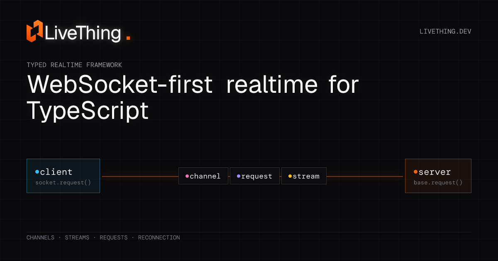

<p align="center">
  <a href="https://livething.dev">
    
  </a>
</p>

<p align="center">
  <a href="https://www.npmjs.com/package/@livething/server"></a>
  <a href="https://github.com/gyenabubakar/livething/actions/workflows/ci.yml"></a>
  <a href="https://bundlephobia.com/package/@livething/client"></a>
  <a href="https://www.typescriptlang.org"></a>
  <a href="./LICENSE"></a>
</p>

<p align="center">
  <a href="https://livething.dev/core/start/introduction">Docs</a> ·
  <a href="https://livething.dev/core/start/quickstart">Quickstart</a> ·
  <a href="https://livething.dev/plugins/collaboration/overview">Collaboration</a> ·
  <a href="https://livething.dev/cloudflare">LiveThing on Cloudflare</a>
</p>

# LiveThing

**LiveThing is a typed, WebSocket-first realtime framework for TypeScript.** You write your server once: its events, requests, channels and streams. The client gets the same types from it, with no code generation and no schema to copy. Rename an event on the server, and the client code that uses it becomes a type error.

It runs on **Node.js** (alone or with Express, Koa, Hono, Fastify or h3) and on **Cloudflare Durable Objects**, with WebSocket hibernation. Where a network blocks WebSocket, the client moves to server-sent events and POSTs, and your code does not change.

## Why LiveThing

- **One contract for both sides.** `InferClient<typeof server>` is the whole client API: events, requests, channels, streams and errors.
- **Every input is checked** with the schema library you already use: any [Standard Schema](https://standardschema.dev) validator, such as Zod, Valibot or ArkType.
- **Pay only for what you use.** Each feature is a capability you list. A feature you leave out adds no code to your bundle.
- **Batteries included:** reconnection, an offline send buffer, requests both ways, rooms, presence and awareness, durable streams, replay of missed messages, an inbox, binary messages, file uploads, scheduled tasks, rate limits and keepalive.
- **Your own servers.** You run it on your own infrastructure, and your data stays in your own SQLite, on Node or in each Durable Object.

## Example

The server declares what it sends and handles:

```typescript
// server/huddle-definition.ts
import { emits, server, t } from '@livething/server';
import * as v from 'valibot';
import type { InferClient } from '@livething/server';

const Status = v.picklist(['active', 'away', 'busy']);

const base = server({
  capabilities: [
    emits({ 'status-changed': t<{ userId: string; status: v.InferOutput<typeof Status> }>() }),
  ],
});

const handleSetStatus = base.on('set-status', {
  input: v.object({ status: Status }),
  run(ctx, input) {
    ctx.broadcast('status-changed', { userId: ctx.user.id, status: input.status });
  },
});

export const huddle = base.assemble({ handlers: [handleSetStatus] });

// This one type is the whole client contract.
export type HuddleSocket = InferClient<typeof huddle>;
```

The client imports only the type:

```typescript
// client/socket.ts
import { client, connect, reconnection } from '@livething/client';
import type { HuddleSocket } from '../server/huddle-definition';

const socket = client<HuddleSocket>()(connect('wss://example.com/huddle'), reconnection());
socket.connect();

// `data` is typed from the server's emits().
socket.on('status-changed', (data) => {
  console.log(`${data.userId} is now ${data.status}`);
});

// Checked against the server's input schema.
socket.send('set-status', { status: 'away' });
```

The [Quickstart](https://livething.dev/core/start/quickstart) runs this on Node.js with Express, and the [Cloudflare adapter](https://livething.dev/core/runtimes/adapters/cloudflare) page runs it on Durable Objects.

## Packages

| Package                                                                                            | What it is                                                                |
| -------------------------------------------------------------------------------------------------- | ------------------------------------------------------------------------- |
| [`@livething/server`](https://www.npmjs.com/package/@livething/server)                             | The server framework: capabilities, handlers, channels and `InferClient`  |
| [`@livething/client`](https://www.npmjs.com/package/@livething/client)                             | The typed client, for browsers, React Native, Node, Bun, Deno and Workers |
| [`@livething/core`](https://www.npmjs.com/package/@livething/core)                                 | Typed errors, close codes and the wire protocol, shared by both sides     |
| [`@livething/server-node`](https://www.npmjs.com/package/@livething/server-node)                   | Run a server on Node.js, alone or with a web framework                    |
| [`@livething/server-cloudflare`](https://www.npmjs.com/package/@livething/server-cloudflare)       | Run a server on Cloudflare Durable Objects                                |
| [`@livething/plugin-collaboration`](https://www.npmjs.com/package/@livething/plugin-collaboration) | Shared documents that many people edit at once, built on Yjs              |

## Install

```bash
# Client
npm install @livething/client @livething/core

# Server on Node.js
npm install @livething/server @livething/server-node @livething/core

# Server on Cloudflare Durable Objects
npm install @livething/server @livething/server-cloudflare @livething/core
```

Bring the schema library you already use. Any [Standard Schema](https://standardschema.dev) validator works, such as Zod, Valibot or ArkType. The examples here use Valibot.

LiveThing is in alpha: its API can change in any release.

## Docs

Everything is at **[livething.dev](https://livething.dev)**: an introduction, a guide to each feature on the server and the client, the runtimes, and the plugins.

## License

[MIT](./LICENSE) © Gyen Abubakar Sadick
